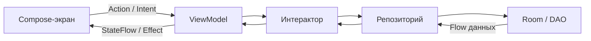

# Shopping List — список покупок

Командный проект Яндекс Практикума, команда 34-1. Android-приложение помогает создавать списки покупок, добавлять товары и отмечать уже купленное.

Описание соответствует реализации в ветке [`develop`](https://github.com/Practicum-OP/shopping-list-team-34-1/tree/develop) на 13 октября 2026 года. Ветка `main` на эту дату содержит стартовый проект.

## Возможности приложения

- Регистрация, вход по email и паролю, восстановление пароля и выход из аккаунта.
- Проверка сохранённой сессии при запуске и обновление токенов авторизации.
- Создание, переименование, дублирование и удаление списков покупок.
- Выбор одной из 30 иконок списка с сохранением выбранного варианта.
- Добавление и редактирование товаров с количеством и единицами измерения: шт., кг, л, мл и г.
- Отметка товаров как купленных и удаление купленных товаров с подтверждением.
- Действия со списками и товарами через свайпы.
- Подсказки названий товаров на основе истории ввода.
- Сортировка товаров по алфавиту и ручное изменение порядка перетаскиванием.
- Светлая и тёмная темы в соответствии с настройками системы.

Списки, товары, история названий и ручной порядок сохраняются локально в Room. Сетевой API используется для авторизации; синхронизация списков с сервером в текущей реализации отсутствует.

## Технологический стек и обоснование выбора

Версии зависимостей централизованно заданы в [`gradle/libs.versions.toml`](gradle/libs.versions.toml), подключение библиотек — в [`app/build.gradle.kts`](app/build.gradle.kts).

| Технология / библиотека | Применение и обоснование |
| --- | --- |
| **Kotlin**; версия Compose-плагина — **2.2.10** | Основной язык приложения. Поддержка nullable-типов, data-классов, sealed-интерфейсов и корутин подходит для моделей данных, контрактов экранов и асинхронных операций. |
| **Jetpack Compose**, BOM **2026.02.01** | Декларативный интерфейс: экран отображает текущее состояние ViewModel. Это упрощает реализацию пустых состояний, диалогов, форм и списков. BOM согласует версии библиотек Compose. |
| **Material 3** | Готовые компоненты, цвета и типографика позволяют использовать общий стиль на всех экранах и поддерживать светлую и тёмную темы. |
| **AndroidX ViewModel и Lifecycle**, **2.11.0** | ViewModel хранит состояние экрана и управляет корутинами. `collectAsStateWithLifecycle()` учитывает жизненный цикл при получении состояния в Compose. |
| **MVI: UiState + Action/Intent + Effect** | Разделение состояния, действий пользователя и одноразовых событий делает поведение экранов предсказуемым и позволяет проверять ViewModel отдельно от интерфейса. |
| **Navigation Compose**, **2.10.1** | Общий навигационный граф связывает авторизацию, главный экран и редактор товаров; аргументы маршрута передают идентификатор и название списка. |
| **Room**, **2.8.5** | Локальное хранение связанных списков и товаров. DAO, транзакции, внешние ключи и миграции помогают сохранять целостность данных и обновлять схему базы. |
| **KSP**, **2.3.10** | Генерирует код Room по аннотациям моделей и DAO, сокращая объём ручного кода доступа к базе. |
| **Koin**, BOM **4.1.1** | Внедрение зависимостей через Kotlin DSL. База, репозитории, интеракторы, сетевые клиенты и ViewModel создаются в явно заданных модулях. |
| **Kotlin Coroutines и Flow**, **1.10.2** | Асинхронные операции с базой и сетью выполняются в корутинах. Flow передаёт изменения данных, StateFlow — актуальное состояние экрана. |
| **Retrofit**, **3.0.0** | Описывает HTTP API авторизации интерфейсом с suspend-функциями, отделяя сетевые запросы от UI. |
| **OkHttp**, logging-interceptor **5.3.0** | HTTP-клиент для Retrofit и журналирование запросов при отладке. В release-конфигурации сетевое журналирование отключено. |
| **Gson**, **2.14.0** | Преобразует JSON-запросы и ответы API в DTO через конвертер Retrofit. |
| **Preferences DataStore**, **1.2.1** | Асинхронно сохраняет access-токен, refresh-токен и идентификатор пользователя между запусками приложения. |
| **detekt**, **2.0.0-alpha.6** | Статический анализ Kotlin-кода с общей конфигурацией ограничений на размер классов, методов и количество параметров. |
| **Gradle Kotlin DSL и Version Catalog**; Gradle **9.5.0**, AGP **9.3.3** | Сборка описана на Kotlin, а версии вынесены в единый каталог. Gradle Wrapper задаёт общую версию Gradle для участников команды. |
| **JUnit 4, kotlinx-coroutines-test, Compose UI Test и Room Testing** | Unit-тесты проверяют логику и состояние экранов; инструментальные тесты — работу базы, миграции и взаимодействие с интерфейсом на Android. |

## Архитектура проекта

Проект состоит из одного Gradle-модуля `app`. Внутри него код разделён на слои `data`, `domain` и `presentation`. Интерфейс построен на Compose, взаимодействие экрана с ViewModel — по MVI.

### Структура пакетов

```text
ru.practicum.shoppinglist
├── data
│   ├── local
│   │   ├── dao          # Запросы к Room
│   │   ├── database     # База данных и миграции
│   │   ├── entity       # Таблицы и вспомогательные модели Room
│   │   └── storage      # Хранилище сессии в DataStore
│   ├── mapper           # Преобразование Entity в доменные модели и обратно
│   ├── network
│   │   ├── api          # Retrofit API авторизации
│   │   └── dto          # Модели сетевых запросов и ответов
│   └── repository       # Реализации репозиториев
├── domain
│   ├── api
│   │   ├── interactor   # Контракты операций со списками и товарами
│   │   ├── model        # Доменные модели
│   │   └── repository   # Контракты репозиториев
│   ├── impl             # Реализации интеракторов
│   └── validation       # Проверка данных авторизации
├── presentation
│   ├── auth             # Проверка сессии, вход, регистрация, восстановление
│   ├── lists            # Главный экран и управление списками
│   ├── editor           # Редактор товаров
│   └── navigation       # Маршруты и навигационный граф
├── di                   # Общие модули Koin
├── ui/theme             # Цвета, типографика, светлая и тёмная темы
├── MainActivity.kt
├── ShoppingListApp.kt
└── ShoppingListApplication.kt
```

### Ответственность слоёв

| Слой | Ответственность |
| --- | --- |
| `presentation` | Отображение экранов, обработка действий пользователя, состояние ViewModel, навигация и сообщения об ошибках. |
| `domain` | Модели приложения, интерфейсы репозиториев, интеракторы и проверки входных данных. Логика не обращается напрямую к Room или Retrofit. |
| `data` | Доступ к Room, DataStore и HTTP API, преобразование моделей, реализация репозиториев и транзакций. |
| `di` | Создание зависимостей и связывание интерфейсов с реализациями через Koin. Модули ViewModel списков и редактора находятся рядом с соответствующими экранами. |
| `ui/theme` | Общая тема, цвета и типографика приложения. |

Поток вызовов для списков и товаров:



Для авторизации ViewModel обращаются напрямую к доменному интерфейсу `AuthRepository`. Его реализация использует `AuthApi` и `AuthTokenStorage`; отдельного интерактора авторизации в текущей структуре нет.

### Контракт экрана и MVI

- **UiState** — состояние экрана: данные, поля формы, загрузка и открытые диалоги. ViewModel публикует его через `StateFlow`.
- **Action / Intent** — действия пользователя. На главном экране используется `ShoppingListsAction` и `onAction()`, в редакторе и формах авторизации — `Intent` и `onIntent()`.
- **Effect** — одноразовое событие, например переход на другой экран или показ Snackbar. События отправляются через `Channel` и читаются как Flow.

Экран получает состояние через `collectAsStateWithLifecycle()` и передаёт действия во ViewModel. Компоненты интерфейса получают данные и callback-функции; переходами управляет навигационный граф.

### Хранение данных и навигация

`ShoppingListDatabase` содержит таблицы списков, товаров и истории названий. Товары связаны со списком внешним ключом с каскадным удалением. Дублирование списка с товарами выполняется в транзакции. Ручной порядок хранится в поле позиции товара, выбранная иконка — как стабильный строковый ключ.

Текущая версия схемы Room — **2**. Миграция `MIGRATION_1_2` сохраняет существующие данные и заполняет историю названий. Экспортированные схемы находятся в [`app/schemas`](app/schemas).

Маршруты объявлены в `AppRoute`, граф — в `ShoppingListNavHost`. При запуске открывается проверка сессии, затем экран входа или списков. Новый список создаётся на главном экране; редактор открывает существующий список по аргументам `listId` и `listName` через `SavedStateHandle`.

Koin запускается в `ShoppingListApplication` и подключает `appModule`, `networkModule`, `listsModule` и `editorModule`.

## Правила командной работы

### Работа с задачами и Git

- Задачи ведутся в [GitHub Issues](https://github.com/Practicum-OP/shopping-list-team-34-1/issues); исполнители закрепляются за задачами.
- `main` — основная ветка репозитория, `develop` — ветка интеграции текущей реализации.
- Каждая отдельная функция разрабатывается в ветке `feature/*` от `develop`, например `feature/auth` или `feature/list_editor`.
- Изменения объединяются в `develop` через pull request и проходят ревью другого участника команды.
- В описании pull request указываются реализованные изменения и результаты проверок. Связанные задачи закрываются после завершения работы; в PR можно использовать `Closes #номер`.

### Правила кода

- Сохраняем разделение слоёв: UI и ViewModel не обращаются напрямую к DAO, Room или Retrofit. Entity и DTO преобразуются в доменные модели в слое `data`.
- Для списков и товаров ViewModel использует интеракторы; для авторизации — интерфейс `AuthRepository`.
- Состояние и действия каждого экрана описываем явным MVI-контрактом. Одноразовые эффекты отделяем от состояния.
- Зависимости передаём через конструкторы и регистрируем в Koin. UI-компоненты получают callback-функции для действий и переходов.
- Общие цвета и типографику берём из темы. Новые пакеты добавляем вместе с реализующими их классами.
- Версии библиотек задаём в Version Catalog. Локальные настройки, ключи подписи, пароли и результаты сборки исключены из Git через [`.gitignore`](.gitignore).
- При изменении структуры Room обновляем версию базы, экспорт схемы и миграцию, проверяем сохранность данных.

Общие ограничения detekt заданы в [`config/detekt/detekt.yml`](config/detekt/detekt.yml): до **350 строк** в классе, до **50 строк** в методе, до **5 параметров** функции или конструктора. Data-классы исключены из проверки количества параметров; функции с `@Composable` исключены из проверки обычного именования функций.

## Команда и вклад участников

Распределение ниже основано на объединённых pull request и истории коммитов в `develop`.

| Участник | Реализованные задачи | Подтверждение |
| --- | --- | --- |
| **Кирилл Портнов** — [@kportnov](https://github.com/kportnov) | Настройка проекта, зависимостей и detekt; базовая архитектура и навигация; доменные модели, Room Entity, DAO, репозитории, mapper-функции и интеракторы; подключение Koin. Сетевой слой авторизации, валидация email и паролей, экраны входа, регистрации и восстановления пароля, хранение и обновление токенов, выход из аккаунта. Светлая и тёмная темы и доработка добавления товаров. | [#1](https://github.com/Practicum-OP/shopping-list-team-34-1/pull/1), [#28](https://github.com/Practicum-OP/shopping-list-team-34-1/pull/28), [#29](https://github.com/Practicum-OP/shopping-list-team-34-1/pull/29), коммиты в [#31](https://github.com/Practicum-OP/shopping-list-team-34-1/pull/31), [#38](https://github.com/Practicum-OP/shopping-list-team-34-1/pull/38) |
| **Ростислав Кучин** — [@etSaikou](https://github.com/etSaikou) | Экран редактора товаров и переход к нему; пустое и заполненное состояния; добавление, редактирование, удаление и отметка купленных товаров; свайпы товаров; интерфейс выбора сортировки. Контекстное меню редактора с пунктами очистки и выбора сортировки, исправление редактирования товаров и замечаний detekt. | [#31](https://github.com/Practicum-OP/shopping-list-team-34-1/pull/31), [#40](https://github.com/Practicum-OP/shopping-list-team-34-1/pull/40) |
| **[@iudicio](https://github.com/iudicio)** | Главный экран, создание и переименование списков, удаление с подтверждением, выбор иконки и обработка ошибок. Свайпы списков, дублирование с товарами, подсказки названий, ручная сортировка с сохранением порядка, набор из 30 иконок, миграция Room 1 → 2. Unit-тесты ViewModel и доменной логики, инструментальные тесты базы, миграции, свайпов и выбора иконки. | [#30](https://github.com/Practicum-OP/shopping-list-team-34-1/pull/30), [#39](https://github.com/Practicum-OP/shopping-list-team-34-1/pull/39) |

Участники также проводили взаимное ревью pull request.

## Видеодемонстрация

**Ссылка на видео: требуется добавить — видеодемонстрация ещё не записана.**

После загрузки записи в Яндекс Диск, Google Drive или другое облачное хранилище замените строку выше ссылкой «Посмотреть видеодемонстрацию». Откройте просмотр всем, у кого есть ссылка, и проверьте доступ в браузере без входа в аккаунт.

Рекомендуемый сценарий демонстрации:

1. Показать регистрацию или вход, валидацию полей и экран восстановления пароля.
2. Создать список с иконкой, переименовать его и продублировать через свайп.
3. Добавить несколько товаров с количеством и единицами измерения, показать подсказки и редактирование.
4. Отметить товар как купленный, переключить алфавитную и ручную сортировку, изменить порядок перетаскиванием, удалить купленные товары.
5. Перезапустить приложение и показать сохранённые данные и ручной порядок, сменить системную тему, удалить список с подтверждением и выйти из аккаунта.

## Запуск и сборка

### Требования

- Android Studio с поддержкой используемых версий AGP и Gradle.
- Android SDK Platform **37** (`compileSdk` и `targetSdk`).
- Устройство или эмулятор с **Android 10 / API 29** либо выше (`minSdk`).
- **JDK 25** для Gradle daemon: версия задана в [`gradle/gradle-daemon-jvm.properties`](gradle/gradle-daemon-jvm.properties). Целевая совместимость Java-кода в модуле `app` — Java 11.
- Доступ к интернету для первой загрузки зависимостей и выполнения запросов авторизации.

### Получение проекта

```bash
git clone --branch develop https://github.com/Practicum-OP/shopping-list-team-34-1.git
cd shopping-list-team-34-1
```

Откройте корень проекта в Android Studio, дождитесь синхронизации Gradle и запустите модуль `app`. Путь к Android SDK задаётся локально в `local.properties` через `sdk.dir` или настройками среды разработки; этот файл не хранится в Git.

Для macOS и Linux:

```bash
bash gradlew assembleDebug
```

Для Windows PowerShell:

```powershell
.\gradlew.bat assembleDebug
```

Debug APK создаётся в `app/build/outputs/apk/debug/app-debug.apk`.

Адрес API авторизации задан в [`NetworkModule.kt`](app/src/main/java/ru/practicum/shoppinglist/di/NetworkModule.kt). Отдельный сервер для локального хранения списков не требуется.

## Проверки качества

Unit-тесты, статический анализ, Android Lint и debug-сборка:

```bash
bash gradlew testDebugUnitTest detekt lintDebug assembleDebug
```

Инструментальные тесты на подключённом устройстве или запущенном эмуляторе:

```bash
bash gradlew connectedDebugAndroidTest
```

В Windows используйте `.\gradlew.bat` с теми же задачами.

Тесты находятся в `app/src/test` и `app/src/androidTest`. Они проверяют состояние экранов, валидацию названий, дублирование списков, подсказки, сохранение порядка, миграцию базы, свайпы и выбор иконки. Результаты выполненных проверок для отдельных изменений указаны в соответствующих pull request.

## Текущий статус

В репозитории остаются открытыми задачи:

- [#15 — release-сборка, оптимизация и подпись](https://github.com/Practicum-OP/shopping-list-team-34-1/issues/15).
- [#18 — проверка смены ориентации](https://github.com/Practicum-OP/shopping-list-team-34-1/issues/18).
- [#19 — поддержка маленьких экранов](https://github.com/Practicum-OP/shopping-list-team-34-1/issues/19).
- [#20 — отдельная версия интерфейса для планшета](https://github.com/Practicum-OP/shopping-list-team-34-1/issues/20).

Полная очистка списка в меню редактора требует доработки: в текущем `ListEditorViewModel` действия `ClearListClicked` и `ClearCheckedClicked` вызывают удаление только купленных товаров. Удаление самого списка реализовано на главном экране.

Для выполнения требования к видеодемонстрации необходимо добавить действительную ссылку на запись с открытым доступом.
